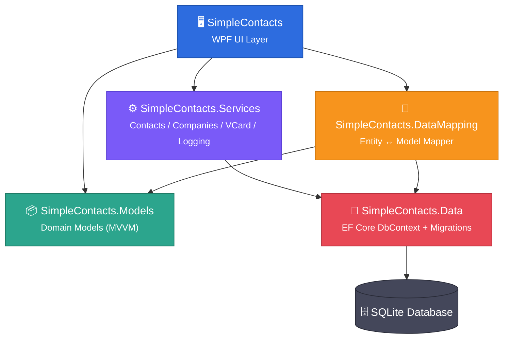
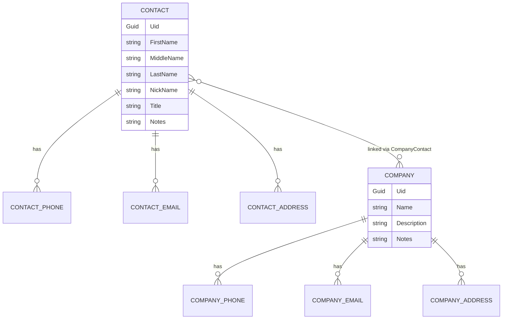

<div align="center">


# 📇 Simple Contacts

### یک اپلیکیشن دسکتاپ مدیریت مخاطبین و شرکت‌ها با WPF و .NET 8

**تم تیره، رابط کاربری سفارشی، معماری چندلایه و پایگاه‌داده SQLite**

<br/>


<br/>

</div>

---

## 📖 درباره پروژه

**Simple Contacts** یک اپلیکیشن دسکتاپ ویندوزی برای مدیریت **مخاطبین** و **شرکت‌ها** است که با **WPF** و **.NET 8** ساخته شده. این پروژه با معماری چندلایه (Layered Architecture) طراحی شده تا منطق داده، مدل‌ها و رابط کاربری کاملاً از هم جدا باشند، و از **Entity Framework Core** روی **SQLite** برای ذخیره‌سازی دائمی داده‌ها استفاده می‌کند.

رابط کاربری با الهام از اسکرین‌شات‌های مرجع، به‌صورت **پیکسل‌به‌پیکسل** بازسازی شده: از رنگ‌های تم تیره گرفته تا آیکون‌های سایدبار، همگی مستقیماً از روی طرح اصلی نمونه‌برداری شده‌اند.

<br/>

## ✨ ویژگی‌های کلیدی

| ویژگی | توضیح |
|---|---|
| 🧑‍🤝‍🧑 **مدیریت مخاطبین** | ثبت نام کامل (First / Middle / Last / Nickname)، چند شماره تلفن، چند ایمیل، چند آدرس و یادداشت برای هر مخاطب |
| 🏢 **مدیریت شرکت‌ها** | ثبت نام، توضیحات، تلفن، ایمیل، آدرس و یادداشت برای هر شرکت |
| 🔗 **لینک مخاطب ↔ شرکت** | رابطهٔ چند‌به‌چند (Many-to-Many) بین مخاطبین و شرکت‌ها با قابلیت افزودن/حذف لینک از هر دو طرف |
| 🏷️ **انواع داده با Enum** | تلفن: `Mobile`, `Home`, `Work`, `Direct`, `Other` · ایمیل: `Personal`, `Work`, `Other` · آدرس: `Home`, `Work`, `Other` |
| ⭐ **مقدار ترجیحی (Preferred)** | هر مخاطب/شرکت یک شمارهٔ تلفن، ایمیل و آدرس «اصلی» دارد که به‌صورت خودکار در لیست‌ها نمایش داده می‌شود |
| 📇 **VCard Import / Export** | سرویس اختصاصی برای ورود و خروجی مخاطبین با فرمت vCard نسخهٔ `3.0` و `4.0` |
| 🔍 **جستجوی زنده** | جستجوی آنی در لیست مخاطبین و شرکت‌ها |
| 🖥️ **تایتل‌بار سفارشی** | نوار عنوان اختصاصی با دکمه‌های Minimize / Maximize / Close و پشتیبانی از Drag & Resize پنجره |
| 📱 **سایدبار جمع‌شونده** | منوی کناری با انیمیشن باز و بسته شدن، هایلایت آیتم فعال و نوار آبی لبه |
| 🔔 **اعلان Toast** | پیام تأیید شناور پس از ذخیره/حذف هر رکورد |
| 🌙 **تم تیرهٔ یکپارچه** | تمام رنگ‌ها، کارت‌ها و استایل کنترل‌ها در یک `ResourceDictionary` مرکزی (`Theme.xaml`) |
| 🗃️ **پایگاه‌داده SQLite + Migrations** | مدل داده با Entity Framework Core و تاریخچهٔ کامل Migration (`InitialCreate`, `AddCompanyNotes`) |

<br/>

## 🖼️ نمای برنامه

<div align="center">

### صفحهٔ جزئیات شرکت


<br/><br/>

### صفحهٔ جزئیات مخاطب


</div>

<br/>

## 🏗️ معماری پروژه

این Solution از **۵ پروژهٔ مجزا** تشکیل شده که هرکدام یک مسئولیت مشخص دارند (Separation of Concerns):



| لایه | پروژه | مسئولیت |
|---|---|---|
| **UI** | `SimpleContacts` | پروژهٔ اصلی WPF: ویوها، تم، تایتل‌بار سفارشی، سایدبار، Toast |
| **Services** | `SimpleContacts.Services` | منطق تجاری: `ContactService`, `CompanyService`, `VCardService`, `LoggerService` |
| **Data Mapping** | `SimpleContacts.DataMapping` | تبدیل دوطرفهٔ Entity ↔ Domain Model (`DataMapper`) |
| **Models** | `SimpleContacts.Models` | مدل‌های دامین مبتنی بر `ObservableObject` (الگوی MVVM با CommunityToolkit.Mvvm) |
| **Data** | `SimpleContacts.Data` | `AppDbContext`، Entityهای EF Core و Migrationها |

<br/>

## 🧱 پشته فناوری (Tech Stack)

<div align="center">

| فناوری | نسخه | کاربرد |
|---|---|---|
|  | `net8.0-windows10.0.19041.0` | فریم‌ورک اصلی |
|  | — | رابط کاربری دسکتاپ |
|  | `8.0.11` | ORM و دسترسی به داده |
|  | `8.3.2` | پیاده‌سازی الگوی MVVM (`ObservableProperty`) |
|  | `latest` | زبان برنامه‌نویسی |
| 🗃️ SQLite | — | پایگاه‌دادهٔ محلی سبک |

</div>

<br/>

## 📂 ساختار پوشه‌ها

```
SimpleContacts.sln
│
├── 📁 SimpleContacts/                         # لایه UI (WPF)
│   └── SimpleContacts/
│       ├── App.xaml / App.xaml.cs             # نقطهٔ ورود برنامه
│       ├── MainWindow.xaml / .cs              # تایتل‌بار، سایدبار، میزبان صفحات، Toast
│       ├── Assets/Icons/                      # آیکون‌های pixel-perfect (۱۷ آیکون PNG)
│       ├── Converters/                        # StringToVisibilityConverter
│       ├── Models/                            # مدل‌های UI (Contact, Company, PhoneEntry, ...)
│       ├── Services/                          # AppServices, DataStore, ModelBridge
│       ├── Themes/Theme.xaml                  # پالت رنگ و استایل کنترل‌ها
│       └── Views/                             # HomeView · ContactsView · CompaniesView
│                                               # ContactEditView · CompanyEditView
│                                               # ImportView · ExportView · SettingsView
│
├── 📁 SimpleContacts.Services/                # لایهٔ منطق تجاری
│   ├── SimpleContacts.Services.Contacts/      # ContactService / IContactService
│   ├── SimpleContacts.Services.Companies/     # CompanyService / ICompanyService
│   ├── SimpleContacts.Services.VCard/         # VCardService (Import/Export .vcf)
│   ├── SimpleContacts.Services.Logging/       # LoggerService
│   └── SimpleContacts.Services.Notifications/ # INotificationService
│
├── 📁 SimpleContacts.DataMapping/             # تبدیل Entity ↔ Model
│   └── DataMapper.cs
│
├── 📁 SimpleContacts.Models/                   # مدل‌های دامین (MVVM)
│   ├── SimpleContacts.Models/                 # Contact, Company, *Phone, *Email, *Address
│   └── SimpleContacts.Models.Enums/           # AddressKind, EmailKind, PhoneKind, LogEntryType
│
└── 📁 SimpleContacts.Data/                     # لایهٔ دیتابیس
    ├── SimpleContacts.Data/                   # AppDbContext, AppDbContextFactory
    ├── SimpleContacts.Data.Entities/           # ContactEntity, CompanyEntity, ...
    └── SimpleContacts.Data.Migrations/         # InitialCreate, AddCompanyNotes
```

<br/>

## 🗂️ مدل داده



هر مخاطب و هر شرکت می‌توانند **چند شماره تلفن**، **چند ایمیل** و **چند آدرس** داشته باشند که هرکدام یک نوع (`Kind`) و یک پرچم **ترجیحی (`IsPreferred`)** دارند. رابطهٔ مخاطب و شرکت نیز از نوع **چند‌به‌چند** است و از طریق جدول واسط `CompanyContactEntity` مدیریت می‌شود.

<br/>

## 🚀 شروع سریع (Getting Started)

### پیش‌نیازها

- ویندوز ۱۰ یا ۱۱
- [.NET 8 SDK](https://dotnet.microsoft.com/download/dotnet/8.0) به‌همراه workload مربوط به **.NET Desktop Development**

> ⚠️ از آنجا که WPF مخصوص ویندوز است، این پروژه فقط باید روی ویندوز (با Visual Studio 2022 یا CLI دات‌نت روی ویندوز) اجرا شود.

### نصب و اجرا

```bash
# کلون کردن مخزن
git clone https://github.com/your-username/SimpleContacts.git
cd SimpleContacts

# اجرای مستقیم با dotnet CLI
dotnet run --project SimpleContacts/SimpleContacts.csproj
```

یا به‌سادگی فایل `SimpleContacts.sln` را در **Visual Studio 2022** باز کرده و کلید **F5** را بزنید.

> 🗄️ در اولین اجرا، دیتابیس SQLite به‌صورت خودکار با آخرین Migration ساخته و به‌روزرسانی می‌شود (`db.Database.Migrate()`).

<br/>

## 🧩 صفحات برنامه

| صفحه | توضیح |
|---|---|
| 🏠 **Home** | داشبورد اصلی با تعداد مخاطبین/شرکت‌ها و بنر فعال‌سازی Import/Export |
| 👤 **Contacts** | لیست مخاطبین + جستجو + جزئیات کامل (نام، تلفن، ایمیل، آدرس، شرکت‌های مرتبط) |
| 🏢 **Companies** | لیست شرکت‌ها + جستجو + جزئیات کامل (تلفن، ایمیل، آدرس، مخاطبین مرتبط) |
| ✏️ **Contact / Company Edit** | فرم کامل ویرایش با امکان افزودن/حذف ردیف‌های تلفن، ایمیل، آدرس و لینک‌کردن به شرکت/مخاطب |
| 📥 **Import** | وارد کردن مخاطبین از فایل VCard |
| 📤 **Export** | خروجی گرفتن از مخاطبین و شرکت‌ها در فرمت VCard (نسخهٔ 3.0 یا 4.0) |
| ⚙️ **Settings** | وضعیت Import/Export، اطلاعات نسخهٔ برنامه و لینک «ثبت نظر» |

<br/>

## 🗺️ نقشه راه (Roadmap)

- [ ] همگام‌سازی ابری (Cloud Sync)
- [ ] پشتیبانی از چند زبان (Localization)
- [ ] خروجی گرفتن به فرمت CSV / Excel
- [ ] جست‌وجوی پیشرفته با فیلتر بر اساس شرکت/شهر
- [ ] نسخهٔ Cross-platform با Avalonia / MAUI

<br/>

## 🤝 مشارکت (Contributing)

مشارکت شما باعث خوشحالی ماست! برای مشارکت:

1. مخزن را Fork کنید
2. یک برنچ جدید بسازید (`git checkout -b feature/AmazingFeature`)
3. تغییرات را Commit کنید (`git commit -m 'Add some AmazingFeature'`)
4. به برنچ خود Push کنید (`git push origin feature/AmazingFeature`)
5. یک Pull Request باز کنید

<br/>

## 📄 لایسنس

این پروژه تحت لایسنس **MIT** منتشر شده است. برای جزئیات بیشتر فایل `LICENSE` را ببینید.

<br/>

---

<div align="center">

ساخته‌شده با ❤️ و ☕ با استفاده از **WPF** و **.NET 8**

⭐ اگر این پروژه برایتان مفید بود، یک ستاره فراموش نشود!

</div>
