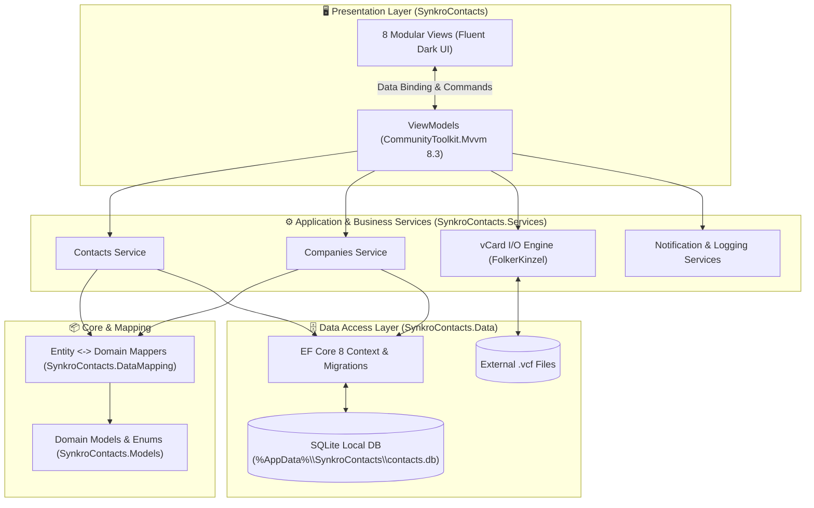
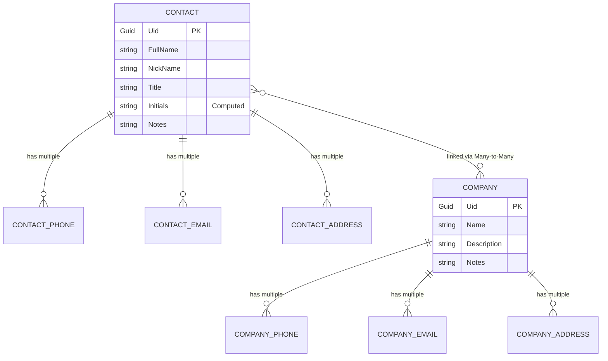

<div align="center">

  

  <br />

  <h1>⚡ SynkroContacts</h1>
  <h3><b>Next-Generation, Local-First Contact & Organization Intelligence for Windows</b></h3>
  <p><i>Built natively with .NET 8, Fluent Dark Aesthetics, and Zero-Cloud Privacy.</i></p>

  <!-- BADGES -->
  <p>
    <a href="https://dotnet.microsoft.com/en-us/download/dotnet/8.0"></a>
    <a href="https://www.microsoft.com/windows"></a>
    <a href="https://learn.microsoft.com/en-us/ef/core/"></a>
    <a href="#-license"></a>
  </p>

  <p>
    <a href="#-why-synkrocontacts"><b>Why SynkroContacts?</b></a> •
    <a href="#-visual-tour"><b>Visual Tour</b></a> •
    <a href="#-key-capabilities"><b>Capabilities</b></a> •
    <a href="#-system-architecture"><b>Architecture</b></a> •
    <a href="#-quick-start"><b>Quick Start</b></a> •
    <a href="#-roadmap"><b>Roadmap</b></a>
  </p>

</div>

<br />

> [!IMPORTANT]
> **Your Network Belongs to You—Not the Cloud.**  
> Most modern address books force your private personal and business relationships into third-party cloud servers, bloated web wrappers, or telemetry-heavy ecosystems. **SynkroContacts** brings back the speed of native Windows software with a zero-telemetry, 100% offline-first SQLite engine.

---

## 🎯 Why SynkroContacts?

**SynkroContacts** is more than a digital Rolodex—it is a lightweight **Personal & Corporate Relationship Manager (CRM)** engineered specifically for Windows 10 and Windows 11. 

Whether you are managing ratusan of client contacts across multiple organizations, keeping track of direct vs. work lines, or maintaining detailed meeting notes, SynkroContacts links **People** and **Companies** into a unified, navigable graph.

* ⚡ **Blazingly Fast Native Performance:** Powered by `.NET 8` and `CommunityToolkit.Mvvm` with source-generated bindings—no Electron, no lag, instant startup.
* 🕸️ **Bidirectional Relationship Graph:** Link a contact to multiple companies, or view an organization's entire roster of associated personnel with one-click cross-navigation.
* 🎨 **Crafted for Dark Mode Lovers:** Designed from the ground up with a high-contrast, distraction-free Fluent dark workspace and customizable accent themes.
* 🔄 **Universal vCard (`v7+`) Engine:** Seamlessly migrate your address book in and out of iCloud, Google Contacts, Outlook, or mobile devices using industry-standard `.vcf` streams.

---

## 📸 Visual Tour

SynkroContacts features a responsive **3-Pane Master-Detail Workspace**—keeping your directory, full entity profile, and contextual scratchpad notes visible simultaneously without modal pop-up fatigue.

### 💠 Cyber Blue Theme
| 👤 People & Contact Intelligence | 🏢 Organization & Company Directory |
| :---: | :---: |
|  |  |
| *Structured name parsing, multi-channel endpoints, and linked organizations.* | *Corporate profiles with direct lines, multiple offices, and linked staff.* |

### 🔶 Amber Gold Theme
| 👤 People & Contact Intelligence | 🏢 Organization & Company Directory |
| :---: | :---: |
|  |  |
| *Instant real-time filtering with smart monogram avatars and inline notes.* | *Seamless bidirectional navigation between companies and contacts.* |

---

## ✨ Key Capabilities

<table>
  <tr>
    <td width="50%" valign="top">
      <h3>🧠 Smart Profile Resolution</h3>
      <p>Contacts aren't flat strings. SynkroContacts breaks down identities into structured components (<code>First</code>, <code>Middle</code>, <code>Last</code>, <code>Nickname</code>, <code>Title</code>) while automatically computing monogram <b>Initials</b> and resolving <b>Primary Endpoints</b> based on your preferred flags.</p>
    </td>
    <td width="50%" valign="top">
      <h3>🏢 Multi-Entity Linking</h3>
      <p>Consultants, executives, and freelancers often belong to more than one organization. Create many-to-many relationships between <b>Contacts</b> and <b>Companies</b> and jump between them effortlessly.</p>
    </td>
  </tr>
  <tr>
    <td width="50%" valign="top">
      <h3>📞 Rich Multi-Channel Endpoints</h3>
      <p>Attach unlimited phone numbers (<i>Mobile, Work, Home, Direct</i>), emails (<i>Personal, Work</i>), and physical addresses to any person or company—each with custom descriptions and priority markers.</p>
    </td>
    <td width="50%" valign="top">
      <h3>📝 Contextual Scratchpad Notes</h3>
      <p>Every contact and company includes a dedicated right-hand <b>Notes Panel</b>. Jot down meeting takeaways, extension numbers, or client preferences right alongside their profile.</p>
    </td>
  </tr>
  <tr>
    <td width="50%" valign="top">
      <h3>📦 High-Fidelity vCard I/O</h3>
      <p>Built on top of <code>FolkerKinzel.VCards</code>, the dedicated Import & Export engine preserves structured names, multiple phone/email types, and metadata when exchanging <code>.vcf</code> files.</p>
    </td>
    <td width="50%" valign="top">
      <h3>🔒 Local-First SQLite Persistence</h3>
      <p>Your entire database lives inside a single, portable SQLite file in your user profile (<code>%AppData%\SynkroContacts\contacts.db</code>). Easy to back up, encrypt, or version-control.</p>
    </td>
  </tr>
</table>

---

## 🏗 System Architecture

SynkroContacts is architected as a **5-layer modular solution**, enforcing strict separation of concerns between the Windows presentation layer, domain models, business services, and Entity Framework Core persistence.



### 🧬 Relational Domain Graph



### 📂 Solution Structure

```text
SynkroContacts.sln
├── 🖥️ SynkroContacts/                  # WinExe UI, Navigation Shell, Themes & MVVM ViewModels
├── ⚙️ SynkroContacts.Services/         # Business Logic, vCard Serialization, Logging & Notifications
├── 🔄 SynkroContacts.DataMapping/      # Bidirectional Translators between EF Entities & Domain Models
├── 🗄️ SynkroContacts.Data/             # EF Core 8 DbContext, Configurations & SQLite Migrations
└── 📦 SynkroContacts.Models/           # Rich Domain Models, Computed Properties & Enums
```

---

## 🚀 Quick Start

### Prerequisites
* **Operating System:** Windows 10 (Version 1809 / Build 17763+) or Windows 11 (`x64`)
* **SDK:** [.NET 8.0 SDK](https://dotnet.microsoft.com/en-us/download/dotnet/8.0)
* **IDE:** [Visual Studio 2022](https://visualstudio.microsoft.com/) (with the **.NET desktop development** workload)

### Build & Run from Source

1. **Clone the repository:**
   ```bash
   git clone https://github.com/YOUR_USERNAME/SynkroContacts.git
   cd SynkroContacts
   ```

2. **Open & Run in Visual Studio 2022:**
   * Open `SynkroContacts.sln`.
   * Ensure the solution platform is set to **`x64`**.
   * Press <kbd>F5</kbd> to build, apply automatic EF Core SQLite migrations, and launch the app.

> [!TIP]
> **Where is my data stored?**  
> On first launch, SynkroContacts automatically provisions your local SQLite database at:  
> `%AppData%\SynkroContacts\contacts.db`  
> To back up your entire address book, simply copy this single file!

---

## 🗺️ Roadmap

- [x] Core Contact & Company CRUD with Master-Detail UI
- [x] Bidirectional Contact ↔ Company relational linking
- [x] Local SQLite persistence with EF Core 8 migrations
- [x] Multi-accent Fluent Dark Themes (Cyber Blue & Amber Gold)
- [x] vCard (`.vcf`) parsing and serialization engine
- [ ] Advanced tag-based filtering & smart groups
- [ ] Encrypted database vault option (SQLCipher integration)
- [ ] One-click CSV / JSON bulk export
- [ ] Global Windows tray quick-search hotkey

---

## 🤝 Contributing

Contributions are what make the open-source community such an amazing place to learn, inspire, and create. Any contributions you make are **greatly appreciated**.

1. Fork the Project
2. Create your Feature Branch (`git checkout -b feature/AmazingFeature`)
3. Commit your Changes (`git commit -m 'Add some AmazingFeature'`)
4. Push to the Branch (`git push origin feature/AmazingFeature`)
5. Open a Pull Request

---

## 📄 License

Distributed under the **MIT License**. See [`LICENSE`](LICENSE) for more information.

<br />

<div align="center">
  
  <br />
  <b>SynkroContacts</b> — Crafted with ❤️ and C# on .NET 8
  <br />
  <sub>If you find this project useful, please consider giving it a ⭐ on GitHub!</sub>
</div>
