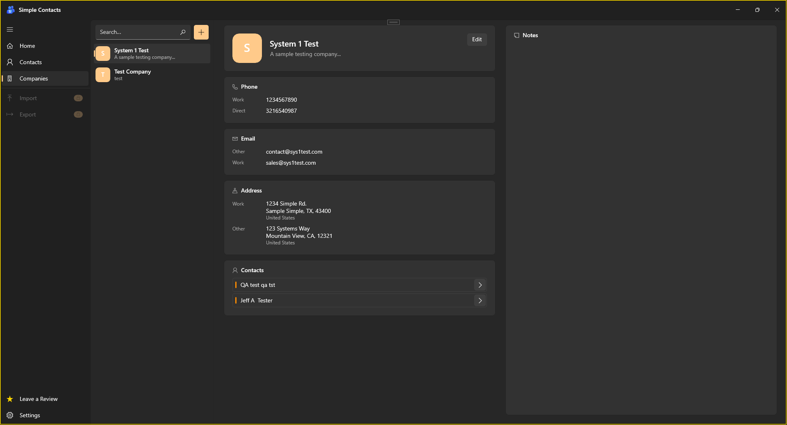
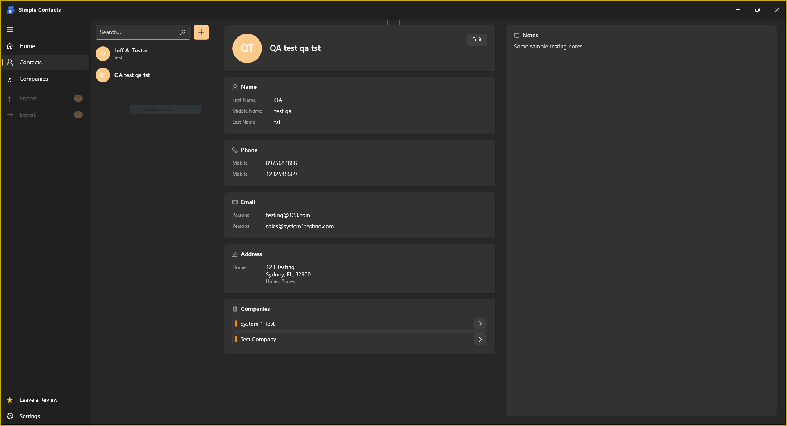

<div align="center">


# SynkroContacts

### A fast, offline-first desktop contact manager for Windows

*Keep people and companies organized, linked together, and a search away — all stored locally, with nothing in the cloud.*

<p>
  
  
  
  
</p>

<p>
  
  
</p>

<p>
  <a href="#-features">Features</a> •
  <a href="#-screenshots">Screenshots</a> •
  <a href="#-getting-started">Getting Started</a> •
  <a href="#-tech-stack">Tech Stack</a> •
  <a href="#-license">License</a>
</p>

</div>

<br>

## ✨ Highlights

- 🔗 **People and companies, properly connected** — not two separate lists, a real relationship graph between them
- 📇 **No field is one-size-fits-all** — multiple phones, emails, and addresses per record, each tagged by kind
- 🔄 **Speaks vCard** — import contacts from any `.vcf` file, export yours the same way
- 💾 **100% local** — a single SQLite file on your disk, no account, no sync, no telemetry

<br>

## 📸 Screenshots

<table align="center">
<tr>
<td align="center" width="50%">

<br>
<sub><b>Company view</b> — contact info, linked people, notes</sub>
</td>
<td align="center" width="50%">

<br>
<sub><b>Contact view</b> — multiple phones/emails/addresses, linked companies</sub>
</td>
</tr>
</table>

<br>

## 🧩 Features

**Core records**
- Manage **Contacts** and **Companies** as full, independent profiles
- Link any contact to one or more companies — view the relationship from either side
- Attach freeform **Notes** to any record

**Rich, structured data**
- Multiple phone numbers, emails, and addresses per record
- Each entry tagged by kind — *Work, Home, Mobile, Direct, Other…*

**Find things fast**
- Instant, as-you-type search across contacts and companies

**Move data in and out**
- **Import** contacts from a standard `.vcf` (vCard) file
- **Export** your contacts to `.vcf` to share or back up

**Private by default**
- Everything lives in a local SQLite database under your own user profile
- No account, no internet connection, no cloud sync — ever

<br>

## 🛠 Tech Stack

<div align="center">

| Layer | Technology |
|:---|:---|
| 🖥️ **UI Framework** | WPF on .NET 8 |
| 🧠 **MVVM Toolkit** | [CommunityToolkit.Mvvm](https://github.com/CommunityToolkit/dotnet) |
| 🗄️ **Data Access** | Entity Framework Core 8 |
| 💽 **Database** | SQLite |
| 📇 **vCard I/O** | [FolkerKinzel.VCards](https://github.com/FolkerKinzel/VCards) |

</div>

<br>

## 🚀 Getting Started

### Prerequisites

- Windows 10 (version 1809) or later
- [.NET 8 SDK](https://dotnet.microsoft.com/download/dotnet/8.0)
- Visual Studio 2022 with the **.NET desktop development** workload

### Run it

```bash
git clone https://github.com/<your-username>/SynkroContacts.git
cd SynkroContacts
```

1. Open **`SynkroContacts.sln`** in Visual Studio 2022
2. Confirm **SynkroContacts** is the startup project *(it is, by default)*
3. Hit **F5** 🎉

> On first launch, the app creates its own SQLite database under `%AppData%\SynkroContacts\` — zero manual setup.

<br>

## 📁 Project Structure

<details>
<summary>Click to expand</summary>

```
SynkroContacts/               # WPF app — UI, views, startup
SynkroContacts.Services/      # Business logic — contacts, companies, vCard, notifications
SynkroContacts.Data/          # EF Core DbContext, entities, migrations
SynkroContacts.DataMapping/   # Mapping between data entities and domain models
SynkroContacts.Models/        # Domain/UI models (MVVM observable objects)
```

</details>

<br>

## 📄 License

Distributed under the **MIT License**. See [`LICENSE`](LICENSE) for details.

<br>

<div align="center">

If this project is useful to you, consider giving it a ⭐ — it genuinely helps.

<sub>Built with WPF and .NET 8.</sub>

</div>
